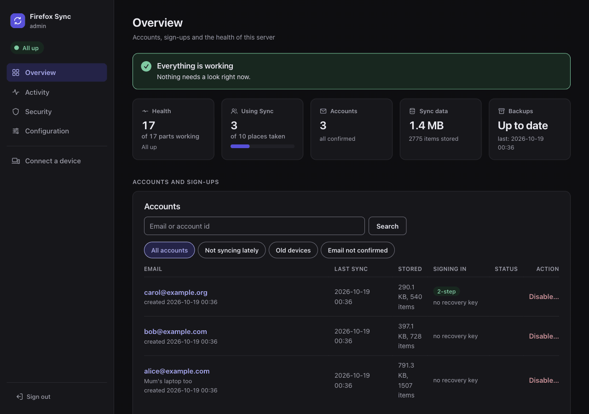
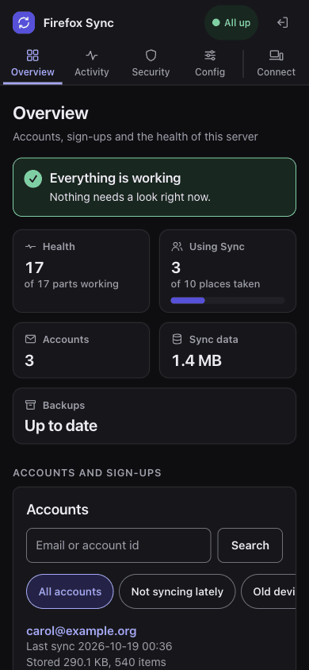

# firefox-sync

Self-host Firefox Sync with Docker, Podman or Kubernetes: your bookmarks, passwords, history, tabs and the rest are stored on your own server instead of Mozilla's. Optionally, the Mozilla accounts too, so that no Mozilla server is involved at all.

Mozilla publishes its Sync server, but not a supported way to run it yourself. This project builds images from Mozilla's code with as few changes as possible, tests them with every database they support, and adds the pieces around them ([why these images](docs/reference/images.md#why-these-images)).

**🐳 Docker, 🦭 Podman and ☸️ Kubernetes (Helm) supported**

## Disclaimer

- ⚠️ The project is under development
- ⚠️ Expect bugs, breaking changes and headache
- ⚠️ **This is not endorsed or supported by Mozilla in any way or form**
- ⚠️ **Do not solely rely on this project to store your bookmarks, passwords and/or other important items**

## Features

- **Sync on your server**: Mozilla's [syncstorage-rs](https://github.com/mozilla-services/syncstorage-rs) and its tokenserver, with the data encrypted by Firefox before it leaves the device.
- **Your own accounts, optionally**: [Mozilla accounts](https://github.com/mozilla/fxa) on your server as well, so that signing in and the account keys stay with you too.
- **Control who uses it**: a limit on the accounts that can use Sync and, with your own accounts, open sign-ups, an allowlist of emails and domains, or none.
- **An admin UI**: accounts, storage, health, setup checks, an event log and Prometheus metrics.
- **Alerts** by email, or to Slack, Discord, Teams, ntfy, Gotify, Telegram, Matrix or any webhook, without an SMTP server.
- **Nightly backups** of every database, watched by the admin UI.
- **Your choice of database**: MariaDB, MySQL or PostgreSQL, in containers or on a server you already run.
- **Three ways to run it**: docker compose, rootless Podman with Quadlets, or a Helm chart.
- **Tested images** for amd64 and arm64, published only after the tests passed.

<p>
  
  
</p>

More in [the admin UI](docs/admin/README.md).

## Choose your path

| You want | You need | Start here |
|---|---|---|
| Sync on your server, Mozilla's accounts, Docker | one HTTPS host name | [Docker compose](docs/install/compose.md) |
| the same with rootless Podman | Podman 4.4 or later | [Podman](docs/install/podman.md) |
| the same on Kubernetes | Kubernetes 1.27 or later, Helm 3 | [Helm](docs/install/helm.md) |
| your own accounts too (no Mozilla server at all) | four HTTPS host names, 3-4 GB of RAM, an SMTP server | the install page, then [self-hosted accounts](docs/accounts.md); with Helm, [its section](docs/install/helm.md#self-hosted-accounts) |
| a database server you already run | MariaDB, MySQL or PostgreSQL | [your own database server](docs/databases.md#your-own-server) |
| to move from another Sync server | | [Migrating](docs/migrating.md) |
| to upgrade | | [Upgrading](docs/upgrading.md) |

## Quick start

```bash
git clone https://github.com/porelli/firefox-sync.git
cd firefox-sync
./prepare_environment.sh
docker compose up -d
```

Then [point your reverse proxy to it](docs/reverse-proxy.md) and [set up Firefox](docs/firefox.md).

## Documentation

Everything else is in [docs/](docs/README.md), also published as a website: [porelli.github.io/firefox-sync-dev](https://porelli.github.io/firefox-sync-dev/).

## Credits

- [Mozilla](https://www.mozilla.org/) for [Firefox](https://www.mozilla.org/firefox) and opensourcing all their software, including the backend
- [jeena](https://github.com/jeena) for [fxsync-docker](https://github.com/jeena/fxsync-docker) which is the inspiration for this project
- [jackyzy823](https://github.com/jackyzy823) for [fxa-selfhosting](https://github.com/jackyzy823/fxa-selfhosting), the reference on running Mozilla accounts outside Mozilla
