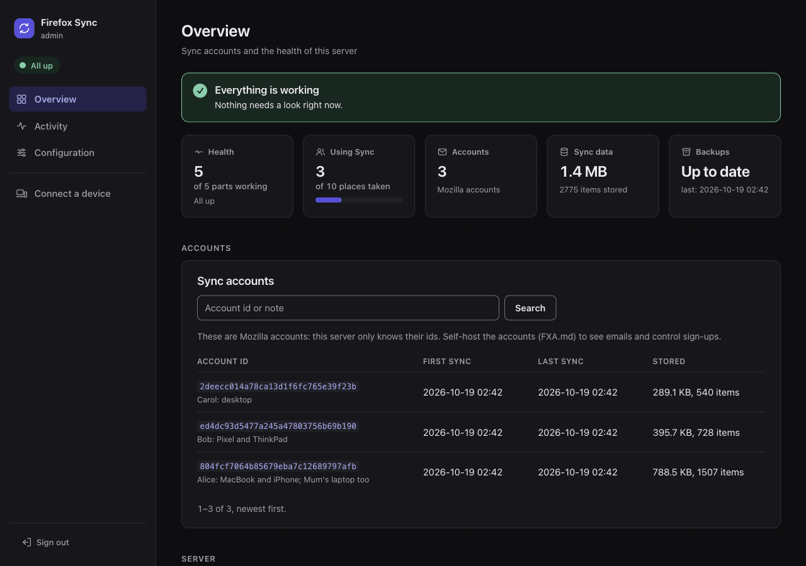

# The admin UI

The admin UI is an optional web page to run your server: who can use it, the accounts, the health of each part, the alerts and the storage. This page says what it does, how to turn it on and reach it, and how its pages behave. Install the stack first, see [the documentation index](../README.md).

## What it does

- **Limits**: max users of Sync and, with self-hosted accounts, max accounts, changed without a restart. See [Limits](accounts.md#limits).
- **Sign-ups and invitations**, with self-hosted accounts: anybody, an allowlist or nobody, and invitations by email. See [Sign-ups](accounts.md#sign-ups).
- **Accounts**: search them, disable them, sign out a device or everywhere, help owners who lost a password or an authenticator, read their security history, keep a note. See [Accounts](accounts.md).
- **Sync data of an account**: what the tokenserver and the storage hold for it, what looks wrong, a reset, a deletion. See [Sync data](accounts.md#sync-data).
- **Monitoring**: the health of each component, versions, public URLs and certificates, setup checks, a read-only Configuration page, Sync activity and errors, the event log and Prometheus metrics. See [Monitoring](monitoring.md).
- **Alerts** by email, or to Slack, Discord, Microsoft Teams, ntfy, Gotify, Telegram, Matrix or any webhook, with no SMTP server. See [Alerts](alerts.md).
- **Storage**: live, expired and orphaned data, a purge, and the daily maintenance. See [Storage](storage.md).
- **Backups**: the last run on the overview, and an alert when one fails. See [Backups](../backups.md).

With Mozilla's accounts there are no sign-ups to control, and the server knows only account ids: the pages show the Sync part only. The notes say whose each account id is.



The pages work on a phone: the side menu becomes tabs at the top and each table row a card ([screenshot](../images/admin/overview-phone.png)). Light or dark follows the system setting. There is no JavaScript: plain links and forms.

The screenshots come from a small demo server with self-hosted accounts: three people with their devices, one more invited. It is rebuilt with [tests/demo_seed.py](/tests/demo_seed.py), see [the screenshot demo](../development/testing.md#the-screenshot-demo). The image itself is described in [Images](../reference/images.md#admin-ui). What its tests cover, and how to run them, is in [Testing](../development/testing.md#admin-ui).

## Set up

`./prepare_environment.sh` asks "Enable the admin UI?" (default yes). It then generates `ADMIN_PASSWORD`, and sets `COMPOSE_PROFILES=admin` and `SYNC_MAX_USERS=initial:<the number you gave>` in `.env`. With self-hosted accounts it also offers to sign in with them, see [Signing in](signing-in.md#self-hosted-accounts).

To turn it on by hand:

1. Add the admin UI's settings to `.env`:

   ```ini
   COMPOSE_PROFILES=admin             # with the pairing server: admin,pairing
   ADMIN_PASSWORD=<at least 12 characters, random>
   ADMIN_EXPORT_PORT=127.0.0.1:8090
   ADMIN_DB_PASSWORD=<random, letters and digits>
   ```

1. Start the stack again:

   ```bash
   docker compose up -d
   ```

| Install | How the admin UI starts |
|---|---|
| docker compose | the `admin` profile of `COMPOSE_PROFILES` |
| Quadlets | starting `firefox-sync-syncstorage.service` also starts `firefox-sync-admin.service` |
| Helm | `admin.enabled: true`, see [the Helm page](../install/helm.md#admin-ui) |

Every setting of the admin UI, with its Helm value, is in [Settings](../reference/settings.md#admin-ui).

`ADMIN_DB_PASSWORD` is the password of the admin UI's own database users. The stack's database containers create them. On your own database server, its setup script does, see [Your own server](../databases.md#your-own-server). What each user may do is in [The admin UI's own database](../reference/database-users.md#the-admin-uis-own-database).

An install from before `ADMIN_DB_PASSWORD` keeps the admin UI's tables in the tokenserver database, and a setup check fails until you set one. See [The admin UI's own database](../upgrading.md#the-admin-uis-own-database) for how they move.

## Reach it

The admin UI listens on `ADMIN_EXPORT_PORT` (`127.0.0.1:8090`): the server itself only. The simplest and safest way to reach it is an SSH tunnel from your computer, without publishing it at all:

```bash
ssh -L 8090:127.0.0.1:8090 your-server
```

Then open `http://localhost:8090`.

- To publish it behind your reverse proxy, see [The admin UI](../reverse-proxy.md#the-admin-ui) on the reverse proxy page.
- On Kubernetes, see [the Helm page](../install/helm.md#admin-ui). There, the pages give `kubectl` and `helm upgrade` commands and the names of the values, instead of `.env` and docker compose.

## Sessions

You sign in with `ADMIN_PASSWORD`, single sign-on or a header of your reverse proxy, see [Signing in](signing-in.md). Every way gives the same session:

- The session cookie is `Secure`, `HttpOnly` and `SameSite=Strict`, and every form carries a token of the session.
- The forms check that they are posted from the same site, so a reverse proxy must keep the `Host` header.
- After 5 wrong passwords in a minute, sign-ins wait a minute.
- A session lasts 12 hours, and ends when the container restarts.
- Over plain HTTP on another host than `localhost`, the cookie needs `ADMIN_INSECURE_COOKIE=1` in the admin UI's container. Compose, the Quadlets and the chart don't pass it from `.env` ([Not in .env](../reference/settings.md#not-in-env)). Not recommended: the Configuration page lists it as a setting that disagrees.

## Time zone

The pages and the alerts show times in UTC. For local time, set `ADMIN_TZ` to a name of the [tz database](https://en.wikipedia.org/wiki/List_of_tz_database_time_zones):

```ini
ADMIN_TZ=Europe/Rome
```

`TZ` works too, and `ADMIN_TZ` wins over it. Each page names the zone once at the bottom, each alert once at the end. A name the admin UI does not know is logged as a warning, and the times stay in UTC. The admin UI carries its own copy of the tz database (the image has none).

## Confirm pages

Nothing destructive happens in one click. Everything that deletes something or cannot be undone first opens a page that says what will happen: the account, and the devices and sessions that get signed out. That page is a `GET` and changes nothing. Its form does the change, a `POST` with the session's token: scripts and the tests use that route directly.

The confirm pages take an optional reason, which goes into the [event log](monitoring.md#event-log). They cover:

- disabling an account, signing out everywhere, signing out a device or a session;
- turning off two-step authentication, removing a recovery key, confirming an email;
- resetting or deleting Sync data, deleting an account, deleting unconfirmed accounts;
- purging the storage, pruning the accounts database;
- removing an email or a domain from the allowlist.

The other forms are one click, because nothing is lost and the result message says what changed:

- Saving the sign-up policy, closing sign-ups too. Saving again undoes it, existing accounts keep working, and the policy's text and radio buttons are a deliberate edit. Entries taken out of the allowlist there are removed with it, as typed.
- Max users and max accounts. Lowering them refuses new accounts only: nobody already in is touched.
- Invitations, a test email, a test notification, enabling an account, lifting a rate-limit block, notes, and signing out of the admin UI.
