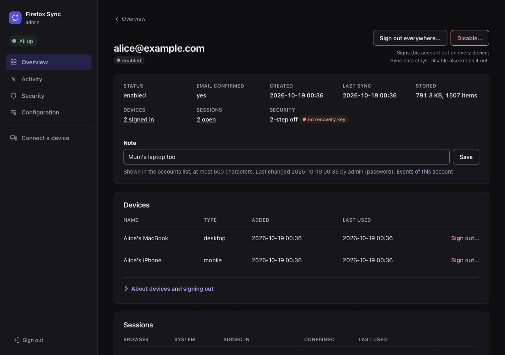
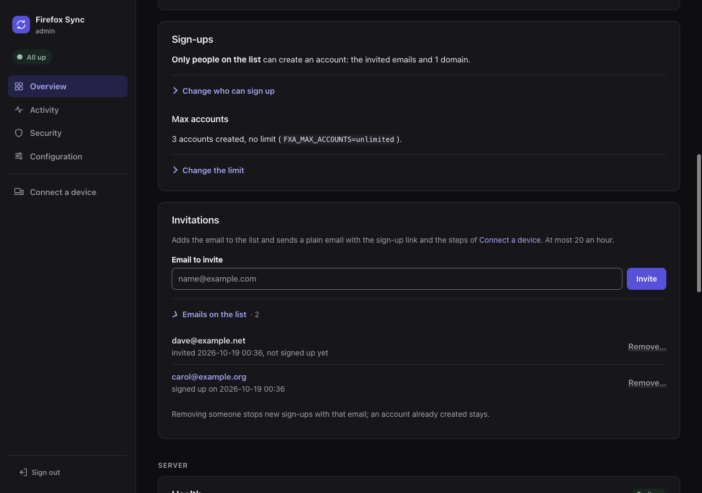

# Accounts in the admin UI

What the [admin UI](README.md) shows and does for the accounts of your server: finding them, the limits, sign-ups and invitations, signing out and disabling, helping their owners, their security history, their Sync data, deleting them, and notes. Most of it needs [self-hosted accounts](../accounts.md); with Mozilla's accounts the server knows only account ids, and the Sync data, deletion and notes parts apply.



The account page: its status, devices and sessions, how it signs in, and its note. Further down are its Sync data per collection, its emails and its security history.

## Find an account

The overview lists the accounts, 50 a page, newest first: who signed up, when they last synced, how much they store and how they sign in, with their note.

The search above the list (a plain form, `/?q=`) finds what contains it, without case:

- part of an email, of an account id, or of a note (with Mozilla's accounts, the label of an account id);
- with a whole number, the account of that tokenserver uid: any of its rows, replaced ones too (a uid as in the storage database or the Sync server's logs);
- with self-hosted accounts, a whole email finds the account of any of its addresses.

The links to the newer and older pages keep the search (`/?q=alice&page=2`). `/find?q=` goes straight to the account page of an exact email, account id or tokenserver uid.

The list marks accounts that need a look. They are only marked, never deleted by themselves:

| Mark | Meaning |
|---|---|
| inactive | not synced for `ADMIN_STALE_DAYS` (90) |
| unconfirmed | email never confirmed after 3 days. Old ones can be deleted, see [Maintenance and retention](storage.md#maintenance-and-retention) |
| `2-step` | two-step authentication on |
| `no recovery key` | no account recovery key |
| `unconfirmed sign-in` | a sign-in that never entered its email code, see [Sign out and disable](#sign-out-and-disable) |
| `blocked` | blocked by the rate limits, see [Helping account owners](#helping-account-owners) |
| `inactive device` | a device not used for `ADMIN_STALE_DAYS`, marked `inactive` on the account page |

All but the first need self-hosted accounts. [Needs attention](monitoring.md#needs-attention) links to the parts of the list.

## Limits

The overview shows the accounts against their limits: in the Using Sync and Accounts tiles, the Sync card, under Sign-ups, and as the `Max users` and `Max accounts` rows of the health table.

- **Max users** of Sync: the form takes a number, or "No limit", which wins over the number. It changes the limit only with `SYNC_MAX_USERS=initial:N`; otherwise it is read-only.
- **Max accounts**, with self-hosted accounts: the same form, under Sign-ups, open when the limit is near or reached. It changes the limit only with `FXA_MAX_ACCOUNTS=initial:N`.

A change applies at once, without a restart. What each form of the two settings means, and what counts, is in [Limits](../limits.md): [`SYNC_MAX_USERS`](../limits.md#sync_max_users) and [`FXA_MAX_ACCOUNTS`](../limits.md#fxa_max_accounts).

The rows turn amber when the limit is near or reached: when that is, and how it alerts, is in [Near and full](../limits.md#near-and-full). Below that, a row shows the count and is not counted by the health light.

## Sign-ups

With self-hosted accounts, Sign-ups on the overview sets who can create an account: anybody, an allowlist of emails and domains, or nobody. What each policy does, how the database enforces it, and how `.env` and the page share it, is in [Who can sign up](../accounts.md#who-can-sign-up).



Under the policy, the page lists the emails of the allowlist, and the domains apart:

- each with when it was added, and whether it signed up yet (`signed up on <date>`, matched without case, as the policy does);
- each with a Remove link to a confirm page (`/accounts/allowlist/remove?entry=...`, whose form posts to `/accounts/allowlist/remove`).

Removing an entry stops new sign-ups with it: an account already created stays. To keep someone out who already has an account, [disable it](#sign-out-and-disable).

Saving the policy removes only the entries the page showed. An invitation sent from another tab, or by another admin after you loaded the page, stays on the allowlist.

## Invitations

**Invite**, under Sign-ups, takes an email. What it does depends on the policy:

| Policy | The email address |
|---|---|
| `allowlist` | added to the allowlist, shown as `invited <date>, not signed up yet` until they do |
| `open` | the allowlist is left alone |
| `closed` | the allowlist is left alone. The page warns that they cannot sign up until you open sign-ups, and the email says so |

It then sends them a plain text email through the stack's SMTP server (`FXA_SMTP_*`, sender `FXA_SMTP_SENDER`):

- the link to create their account, `FXA_CONTENT_URL/?email=<their email>`, which opens the sign-up page with that email;
- the steps to point Firefox on a computer, Android and iOS to this server, and to pair a phone from a computer.

No HTML, no images, no tracking: the links are the plain URLs of your server. Without an SMTP server the entry is still added, and the page says the email was not sent.

At most 20 invitations an hour go out, whoever sends them, so a stolen session cannot make your SMTP server a spammer. Each one is in the event log.

**Connect a device**, in the menu, shows the same steps on a page, with this server's values. See [From the admin UI](../firefox.md#from-the-admin-ui).

## Sign out and disable

Three actions, from the strongest:

| Action | Where | What it does |
|---|---|---|
| **Disable** | the accounts list or the account page, then the confirm page | signs the account out of every device, refuses new sign-ins, and revokes its OAuth tokens, in the accounts database and in Redis. **Enable** gives the account back, with its data, after a new sign-in |
| **Sign out everywhere** | the account page | the same for the devices, sessions and tokens, but the account stays active: its owner can sign in again right away. Use it after a lost laptop, or a leaked password (with a new password) |
| **Sign out** a device or a session | next to it, on the account page | removes that device and the session or refresh token it signed in with, so it cannot get new access tokens |

**Firefox keeps syncing for up to about an hour after any of them.** The Sync server remembers a verified access token for 5 minutes, and a Sync token it handed out stays valid for up to 1 hour. After signing out a single device, the access tokens it already has also keep working until they expire (`FXA_ACCESS_TOKEN_LIFETIME`, `60 minutes`). To lock every device out at once, sign out everywhere.

`FXA_ACCESS_TOKEN_LIFETIME` takes any duration (`2 hours`). Revoking makes it irrelevant for disabled accounts. A short one is a backstop in case revoking fails (the page tells you), at the cost of Firefox asking for a new token every hour, which a small server does not notice. Mozilla's default is `365 minutes`.

Keep the lifetime as it is if you turn on JWT access tokens (`JWT_ACCESS_TOKENS_ENABLED_CLIENT_IDS`, off by default). Those living 6 hours or less are checked by their signature only, and cannot be revoked.

Signing out goes through Mozilla's own procedure, `revokeAccountTokens_1`: sessions, key fetch, account reset, password change and password reset tokens, unconfirmed sign-ins, unblock codes and devices, then the OAuth tokens and codes. Mozilla's own admin panel, not part of this stack, disables accounts the same way, without revoking the tokens.

**If an action answers with an error**, a Mozilla procedure it needs may be missing. `fxa-policy` checks at every start that they exist, and logs a warning with the name of a missing one. The accounts keep working, but what needs it fails. Update the admin UI image, or, on your own database server, grant `EXECUTE` on `fxa.*` to the policy user. How the admin UI reaches the accounts database is in [The accounts](../reference/database-users.md#the-accounts).

### Devices and sessions

The devices and sessions on the account page say whether they are confirmed, and when they were really last used:

- The accounts service writes most uses to its Redis only. The admin UI reads them there once per account page, and shows the later of the two.
- The stack has it record every use (`LASTACCESSTIME_UPDATES_SAMPLE_RATE=1`). Mozilla samples 30% of the accounts.
- That cache holds the session token ids: the admin UI turns each into its hash right away and keeps nothing else.

A session that never entered the code sent by email, or the second step, is marked `unconfirmed sign-in`, in the list too. It cannot sync. A sign-in you do not expect there means someone has the password.

## Helping account owners

The account page of a self-hosted account shows how it signs in, without any secret. The admin UI never reads the authenticator's key, the backup codes, the recovery key's data or the phone number.

- two-step authentication (an authenticator app), with the backup authentication codes left, and whether a recovery phone is set;
- whether it has an account recovery key, and its passkeys;
- when the password was last set, and the keys last changed;
- all its emails, primary and secondary, and whether they are confirmed. A secondary email is in the accounts database once confirmed.

### They forgot their password

They use Forgot password at `FXA_CONTENT_URL/reset_password` themselves. With a recovery key nothing is lost.

Without one, the reset gives the account new keys, and the Sync data on the server can no longer be read. They first open Firefox on a device that still has the data, so it uploads it again after the reset. The account page says so.

### They lost their authenticator app

And their backup codes too:

1. **Make sure who is asking.** From then on, the password and the mailbox are enough to get in.
1. Click **Turn off…** next to two-step authentication on the account page.
1. On the confirm page, keep "sign out everywhere" on (the default), so that if someone else got in, they are out too.

It removes the authenticator, the backup codes and the recovery phone in one transaction (Mozilla's `deleteTotpToken_4`). They then sign in with the password and a code sent by email.

### A recovery key leaked

Click **Remove…** next to it (Mozilla's `deleteRecoveryKey_2`). The confirm page has the same choice to sign out everywhere.

After either of these, the owner gets a plain email from the stack's SMTP server (`FXA_SMTP_SENDER`), such as "An administrator turned off two-step authentication on your account", with a link to the account settings to set it up again. The admins get the alert of the change. Without `FXA_SMTP_HOST` nothing is sent, and the page says so.

### Their confirmation email never arrived

Click **Confirm the email…** on the account page of an unconfirmed account. It skips the proof that whoever signed up owns the address: do it only when you know who they are.

Their current sign-in stays unconfirmed: signing in again sends a new code to the address. Confirming pending sign-ins themselves is not offered.

### They are blocked

After too many wrong passwords or codes, the accounts service blocks them. The list marks them `blocked`, and the account page says until when, with a **Lift** button. The Security page, in the menu, lists every block and who is getting close, with the same button.

Every round of checks (every minute) the admin UI reads the blocks:

- A new block of an existing account is recorded and alerted once per account and action: on its email (alone or with an IP address) or its uid.
- Blocks of emails that have no account, and of IP addresses alone, are left to the Security page: anybody can cause those.
- Thousands of those do not hide the block of an account. The admin UI reads the names of all blocks (up to 100,000; past that every page says so), and the details only of those of accounts.
- The Security page lists the blocks of accounts first, then at most 1,000 others, and says how many it leaves out.

Each of these changes is in the event log, with who made it, the account's email and the reason given. The profile server's cache of the account is dropped afterwards, so the account settings show the change at once.

## Security history

With self-hosted accounts and `FXA_ACCOUNT_EVENTS=true`, the account page lists its security history: the newest 50 entries, as its owner sees them in Recent activity of the account settings. The setting is off by default, because it keeps the IP address of every sign-in: see [Security history](../accounts.md#security-history) for what it changes and keeps.

Each entry shows:

- the event: signed in, wrong password, password changed or reset, two-step authentication on or off, recovery key created or removed, backup codes, emails, passkeys, signed out, and Mozilla's name for the others;
- when, and the IP address;
- whether the sign-in of the event was confirmed. `not confirmed` means its code or second step was never entered, which for a sign-in you do not expect means someone has the password.

With the setting off, the page says how to turn it on, and still lists what was recorded before.

### Alerts

These events, made by the owner in the account settings (or whoever has their session), are events of kind `security` in the event log and the [alerts](alerts.md):

```text
alice@example.com (uid 3f2a1b2c): password changed, from 203.0.113.5
```

They have the caps of every kind: 30 a minute in the log, 20 a message. The alerts then carry IP addresses too.

| Alert | Mozilla's event |
|---|---|
| password changed | `account.password_changed` |
| password reset (forgotten password) | `account.reset` |
| password set (an account without one) | `account.password_added` |
| primary email changed | `account.primary_secondary_swapped` |
| two-step authentication turned on, turned off, authenticator app replaced | `account.two_factor_added`, `account.two_factor_removed`, `account.two_factor_replace_success` |
| backup codes created, replaced | `account.recovery_codes_created`, `account.recovery_codes_replaced` |
| recovery key created, removed | `account.recovery_key_added`, `account.recovery_key_removed` |
| passkey added, removed | `account.passkey.registration_success`, `account.passkey.removed` |
| recovery phone added, replaced, removed | `account.recovery_phone_setup_complete`, `account.recovery_phone_replace_complete`, `account.recovery_phone_removed` (no SMS here, unless you add it) |

Not alerted:

- `account.password_reset_success` ("new password saved"), which Mozilla records next to `account.password_changed` on every password change;
- the backup codes saved while turning on two-step authentication (`account.recovery_codes_set`), which come with its alert.

What the admin UI itself turns off or removes is in the audit trail already (kind `admin`): Mozilla's procedures it calls record no security event. Prometheus counts every event by its name, see [Prometheus](monitoring.md#prometheus).

After a restart, an upgrade or a host that was off, the admin UI reads on from where it stopped, at most `ADMIN_RETENTION_DAYS` back. So a password changed, two-step authentication turned off, or a recovery key added in the meantime is alerted once, late, and not twice. Without `ADMIN_DB_PASSWORD`, and at the first start of a release with it, events from before the start of the admin UI are not alerted.

<details><summary>How it reads the history, and what it costs</summary>

Every round of checks the admin UI reads the new events of every account, oldest first, by pages of 10,000 and up to 100,000 a round. A burst (thousands of wrong passwords, a catch-up after the accounts database was down) only delays the next ones to the following rounds: none is skipped. Where the reading is, and the alerted events it may read again, are kept in the admin UI's database (`ffs_meta`) after every page.

Mozilla's table has no index on the time of the events, so each round scans all of `fxa.securityEvents` (on your server with `EXTERNAL_DB`), as the daily pruning does. Kept for 30 days on a server of a few people, that is a few thousand rows: nothing. With thousands of accounts or a long `ADMIN_RETENTION_DAYS`, keep an eye on it. The stack does not change Mozilla's tables.

The admin UI reads the history through the view `ffs.security_events`. What it reads of each entry, and how long the entries are kept: [Security history](../accounts.md#security-history).
</details>

## Sync data

The account page lists every row the tokenserver has for the account. syncstorage-rs adds one, with a new uid and new, empty storage, each time the account's keys change: a password reset without the recovery key, for example. The current one, where Firefox syncs, is marked.

For each row it shows:

- its uid (the user id in the storage) and its client state (a hash of the keys);
- keys changed at, as Firefox sends it;
- its node, when it was created and replaced;
- what its storage holds, per collection (bookmarks, history, passwords...): items, size, last change. The data itself is encrypted by Firefox: the server cannot read it.

With self-hosted accounts the page also shows when the accounts service last changed the keys and set the password. The generation is not shown: with OAuth sign-ins it is always 0.

What looks wrong is said in one line each:

| Flag | What it means |
|---|---|
| Several current rows | more than one row is not replaced: the tokenserver uses the newest, and what the others store is never read |
| Keys went back in time | a row has an older `keys_changed_at` than the one before it: a device with old keys, or the accounts database restored from a backup |
| Keys changed without a date | new keys (client state) with the same `keys_changed_at`: the accounts service did not record the change, and devices may disagree on the keys |
| Unknown node | the current row points to a node the tokenserver does not have: Sync tokens fail |
| Node retired | the current row is on a downed node: the next sign-in moves the account to empty storage |
| Data left on old keys | the current storage is empty while a replaced row still holds data: encrypted with the old keys, Firefox cannot read it. A device that still has the data uploads it again |

### Reset the Sync data

**Reset the Sync data**, on the account page and then the confirm page, deletes what the storage holds for the current row. It keeps the account and its tokenserver row. Each Firefox finds the server empty on its next sync, and uploads what it has again. Data that is only on the server is lost.

**Reset…** next to a collection deletes that collection only. Firefox does not notice it by itself: it sends again what changes on a device, or everything after Sync is reset there (disconnect, then sign in again).

The checkbox **also free the max users slot** deletes the account's tokenserver rows too, with the storage of each. The account no longer counts towards max users, and its next Sync token goes through the limit again: refused when the server is full.

Every reset is in the event log and the alerts. It deletes 1000 items at a time, so the Sync server keeps answering: on MariaDB from `bso`, `user_collections`, `batch_uploads` and `batch_upload_items`; on PostgreSQL from `bsos`, then `user_collections`, which takes the batches with it.

## Delete an account

Deleting is for a disabled account only:

1. [Disable](#sign-out-and-disable) the account.
1. Click **Delete the account for good…** on its page.
1. Type its email on the confirm page.

`ffs.delete_account` refuses an account that is not disabled, whatever sends the request.

What goes:

- **In the accounts databases**, in one transaction: its recovery phone; its OAuth codes, refresh and access tokens, activity and consents (`fxa_oauth`); its profile and avatars (`fxa_profile`); its push messages (`pushbox`). Then Mozilla's own deletion (`deleteAccount_24`, reason `fxa_admin_requested_account_delete`): sessions, keys, devices, emails, two-step authentication, recovery key and codes, security events.
- **On the allowlist**: its exact email, so that with sign-ups on an allowlist it cannot sign up again unless invited.
- **In Redis**: its access tokens, the cache of its sessions and refresh tokens, its profile.
- **On the Sync side**: every tokenserver row of `<uid>@<FXA_EMAIL_DOMAIN>`, with the storage of each, which frees its max users slot.
- **Its note.**

Firefox can keep writing for up to an hour with the Sync token it has. A second pass deletes that storage again 65 minutes later. A restart of the admin UI forgets that pass; the [purge](storage.md#purge) then finds that storage, which has no tokenserver row.

If something fails once the account is gone from the accounts database (Redis, the Sync data, the note), the page says what. The event log still records the deletion, with the error. Delete the Sync data again from the account's page, which stays as long as tokenserver rows are left.

The event says who was deleted, with the email, by whom and why. An avatar image, if the owner uploaded one, stays in the `fxa-profile-images` volume: the files are named by a random id, not by the account.

With Mozilla's accounts, or for an account id whose self-hosted account is gone, the same page deletes the Sync data and the tokenserver rows of the account id: type the id to confirm. The account itself is Mozilla's: it can sync here again, as a new account.

## Notes

Each account has a note, up to 500 characters on one line: who it is, why it was disabled. Edit it on the account page.

- The accounts list shows it under the email. With Mozilla's accounts it shows next to the account id, where it is the only way to tell whose an account is.
- The reason given when disabling an account is added to its note.
- Notes are kept in the admin UI's database (`ffs_account_notes`), with who changed them last, and every change is in the event log.

Like the event log, notes are personal data. Deleting an account for good removes its note: from its page, by the purge, or with the old unconfirmed accounts.
