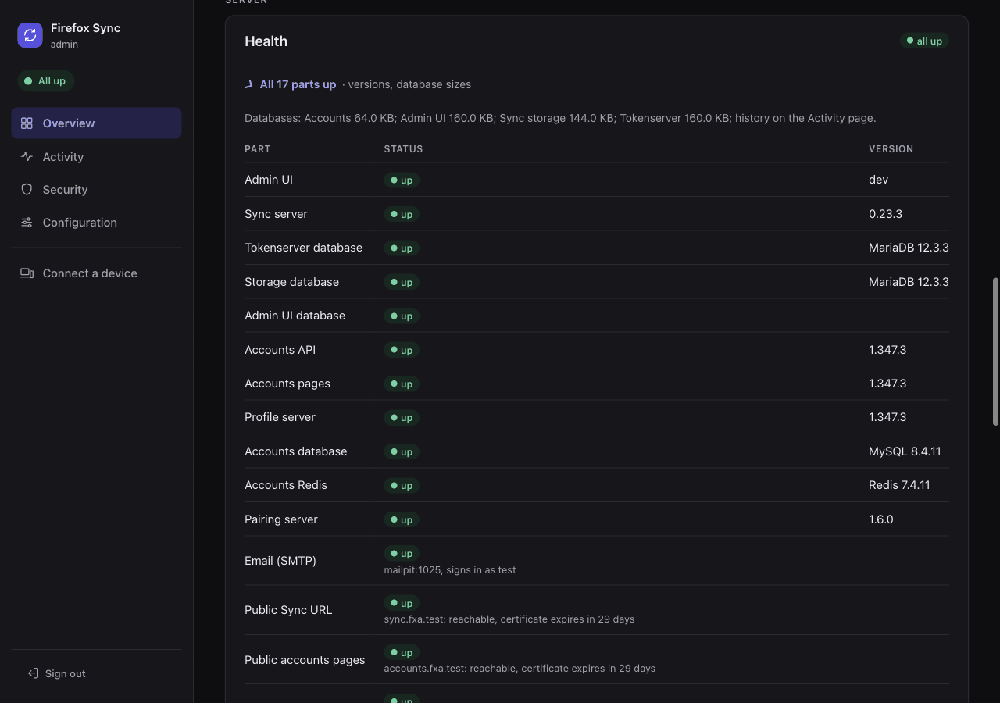
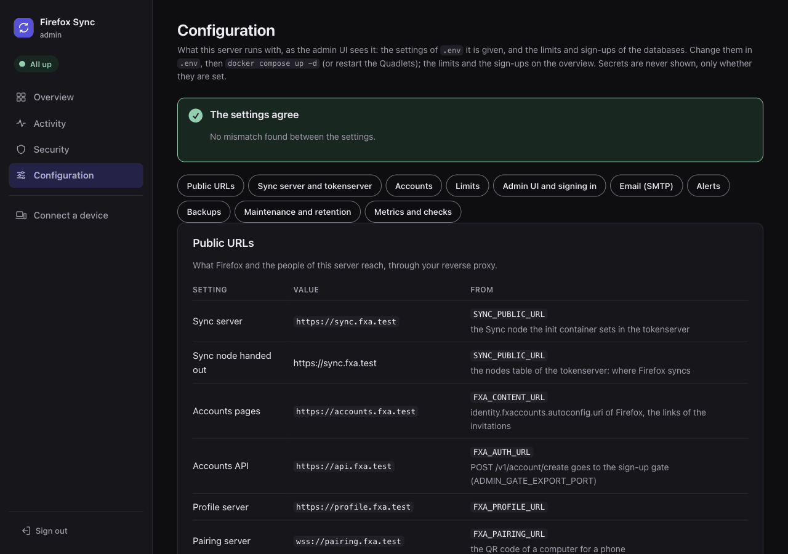
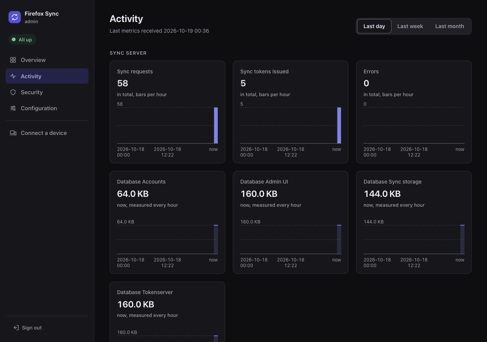

# Monitoring

What the [admin UI](README.md) watches on your server, and where it shows it: the Health table, Needs attention, the checks of your public URLs and your settings, the Configuration page, the Activity page with its event log, and the Prometheus metrics. Alerts on all of this are in [Alerts](alerts.md).

## Health

The Health part of the overview shows, for each component, whether it answers its health check: the Sync server, the databases and, with self-hosted accounts, the accounts services. It also shows:

- the versions running, and whether a newer release is out, see [Versions and schema levels](#versions-and-schema-levels);
- the limits: the accounts against max users and max accounts, see [Limits](accounts.md#limits);
- the Email (SMTP) row and the Notifications row, see [Alerts](alerts.md);
- the public URLs with their certificates, see [Public checks](#public-checks);
- rows that appear only when they have something to say: `Sync metrics`, `Sync error rate`, `Database growth`.

A health light on every page ("All up", "1 part to check", "2 parts down") links to the Health part of the overview. The checks run every minute, a "round of checks".



## Needs attention

The top of the overview lists what to look at now, one line each, with a link to where it is fixed. A line is amber, or red when a component is down. With nothing to list it says "Everything is working", in green.

| Line | Link |
|---|---|
| a component down (the Health table), or the sign-in keys of `FXA_OAUTH_SERVER_URL` | Health, Setup |
| a newer release of a component | Health |
| a certificate of a public URL expiring in less than 14 days | Health |
| sign-ups that bypass the sign-up gate, see [Public checks](#public-checks) | Health |
| the SMTP server does not work, or the last alert email failed | Health, the alert status |
| max users near or at the limit, see [Near and full](../limits.md#near-and-full) | the max users form |
| self-hosted accounts: max accounts near or at the limit | the max accounts form |
| a backup failed, or the last good one is older than 36 hours | [Backups](../backups.md) |
| orphaned Sync data, see [Storage](storage.md) | the purge |
| Sync data changed without metrics from the Sync server: it needs a restart, see [Sync metrics](#sync-metrics) | Activity |
| a spike of Sync errors, or a database growing fast, see [Errors and growth](#errors-and-growth) | Activity |
| self-hosted accounts: accounts blocked by the rate limits | Security |
| accounts that never confirmed their email; accounts with an unconfirmed sign-in | the list of those accounts (one account: its page) |
| devices not used for `ADMIN_STALE_DAYS` (90) | the list of those accounts (one account: its devices) |
| the accounts database not pruned for 2 days, see [Maintenance and retention](storage.md#maintenance-and-retention) | Activity |

The links to a part of the list show only those accounts: `/?show=blocked`, `unconfirmed`, `unconfirmed-sign-in`, `inactive`, `inactive-devices`.

Some lines also alert, as events of kind `attention`: the limits (see [Near and full](../limits.md#near-and-full)), Sync data changed without metrics, alert emails failing, a spike of errors, a database growing fast. Each alerts once when its state changes, not every minute, and at the start of the admin UI when it is already the case. The other lines have alerts of their own already (components, releases, certificates, blocks, backups).

The limits, the error rate and the growth are also rows of the health table. The health light counts them as "to check" only when they are near or over.

## Public checks

Every hour the admin UI looks at your server from the outside, the way Firefox does. It checks each `https://` URL: the Sync node the tokenserver hands out and, with self-hosted accounts, `FXA_CONTENT_URL`, `FXA_AUTH_URL` and `FXA_PROFILE_URL`.

1. It opens a TLS connection and reads the certificate.
1. It asks `/__heartbeat__` through your reverse proxy.

The Health table then shows `reachable, certificate expires in N days`. Under 14 days left, or when the URL does not answer, the row turns to a problem, with an event and an alert. While a check fails it runs again every 5 rounds of checks, so a name the server cannot reach does not hold up the other checks. A Sync node the tokenserver no longer hands out (downed or removed) leaves the metrics.

With self-hosted accounts it also checks that `POST /v1/account/create` of `FXA_AUTH_URL` reaches the sign-up gate (see [Who can sign up](../accounts.md#who-can-sign-up)). It sends a request with an empty body and a header carrying a random token of this start of the admin UI:

- The gate answers it itself (204, with the token) and passes nothing on.
- A reverse proxy that sends sign-ups to the accounts service directly passes the empty body on, and the accounts service refuses it: the row says the gate is bypassed.
- The probe never creates an account, whatever the sign-up policy.

"not reachable from the server" means the server could not connect to its own public name. Often that is split DNS (the name resolves to another address inside your network) or a firewall, or the server cannot reach its own public address (hairpin NAT). Firefox may well reach it from outside. If you want the check, add the name to the server's `/etc/hosts` or your local DNS.

`http://` URLs and unset ones are not checked. `ADMIN_PUBLIC_CHECK=false` (or `0`) turns all of them off, and with them the check of `FXA_OAUTH_SERVER_URL` when it is on the internet (Mozilla's accounts).

## Setup checks

The overview lists settings that must agree with each other, each with what goes wrong when they do not:

- **Sync node**: the tokenserver hands out the Sync node of its `nodes` table, which the init container sets from `SYNC_PUBLIC_URL` when it starts. When they differ (`.env` changed, the stack not restarted), the warning names both: Firefox syncs with the one of the table.
- **Sign-in keys** (`FXA_OAUTH_SERVER_URL`): the Sync server checks every sign-in of Firefox with the keys at `FXA_OAUTH_SERVER_URL/jwks` (`/v1` added when missing). Checked every hour. With Mozilla's accounts that is Mozilla's server, so it is checked only with the public checks on.
- **Email of the accounts** (`FXA_SMTP_HOST`), with self-hosted accounts: without an SMTP server nobody can sign up or sign in, see [Do you need an SMTP server?](alerts.md#do-you-need-an-smtp-server). Without self-hosted accounts there is no such check.
- **Account emails** (`FXA_EMAIL_DOMAIN`): the tokenserver keeps each account as `<uid>@FXA_EMAIL_DOMAIN`. After `FXA_EMAIL_DOMAIN` changed, everybody comes back as a new account, with empty storage, and counts twice against max users. The warning names the domain set and the others found, with how many accounts each.

The Sync nodes table, in the Sync section, shows for each node the accounts on it (those whose current keys are there), its capacity, current load, places available and backoff.

## Configuration page

The Configuration page (`/config`, in the menu) shows the settings the admin UI runs with, read-only, so you can check them without opening `.env`. They are grouped by part: public URLs, Sync and its databases, the accounts, the limits, signing in, email, alerts, backups, maintenance, metrics.



Each setting shows its value, the variable it comes from (or `(default)` when it is not set), and what it does:

- **Database servers**: with the version the health checks read from them. On your own server, only MySQL or MariaDB until the first check.
- **Switches** are read as the admin UI reads them: `ADMIN_INSECURE_COOKIE` and `ADMIN_SMTP_INSECURE_AUTH` with `1`, `true` or `yes` (another value than those and `0`, `false`, `no` stops the admin UI at its start), `ADMIN_UPDATE_CHECK=false` and `FXA_SMTP_SECURE=true` exactly.
- **The Sync databases**: with the user the admin UI connects as, `ADMIN_DB_SYNC_USER`, next to its own database (`ADMIN_DB_USER`, `ADMIN_DB_NAME`). An install from before `ADMIN_DB_PASSWORD` shows the Sync server's users, and the event log in the tokenserver database.
- **Thresholds** of [Errors and growth](#errors-and-growth) and the [security history](accounts.md#security-history), as in force.
- **The limits and the sign-up policy**: what is in force in the database, and where it comes from. `SYNC_MAX_USERS=initial:5` says the overview manages it (and what it is now), `SYNC_MAX_USERS=5` that the init container sets it on every start.

To change a setting, edit `.env` and start the stack again, or with the Helm chart your values and `helm upgrade`. On Kubernetes the page names the values as the variables of `.env`. The limits and the sign-ups are changed on the overview.

**Secrets are never on the page**, only "set" or "not set": `ADMIN_PASSWORD`, `ADMIN_OIDC_CLIENT_SECRET`, `ADMIN_METRICS_TOKEN`, `FXA_SMTP_PASS` and the passwords of the databases. A password inside a URL is hidden too, and the destinations of `ADMIN_NOTIFY` show as `scheme://host` only. The admin UI does not get the other secrets of `.env` at all (`SYNC_MASTER_SECRET`, the keys of the accounts service).

<details><summary>Why no secret can end up there</summary>

Every variable the admin UI reads, or is given by compose and the Quadlets, is listed in the program as a secret or not. A unit test fails on a new one that is not, so a future setting cannot reach the page by default.

For this page the admin UI also gets a few settings it does not use itself, none of them secret: `SYNC_DB`, `ADMIN_EXPORT_PORT` and, with the accounts, `FXA_DB`, `ADMIN_GATE_EXPORT_PORT`, `FXA_CLIENT_ADDRESS_DEPTH` and `FXA_ACCESS_TOKEN_LIFETIME`.
</details>

### Settings that disagree

On top, the page lists the settings that disagree, found without asking anything outside:

- the [setup checks](#setup-checks) that fail;
- a public URL that is not `https://` (`SYNC_PUBLIC_URL`, `FXA_CONTENT_URL`, `FXA_AUTH_URL`, `FXA_PROFILE_URL`; `http://localhost` is fine), or a pairing server that is not `wss://`;
- two public URLs on the same host name: each needs its own, see [Host names and ports](../reverse-proxy.md#host-names-and-ports);
- with self-hosted accounts, `FXA_EMAIL_DOMAIN` other than the host of `FXA_AUTH_URL`, or `FXA_OAUTH_SERVER_URL` pointing to other accounts than these (Mozilla's);
- the [trusted header](signing-in.md#trusted-header) with `ADMIN_EXPORT_PORT` on an address other than loopback;
- `ADMIN_OIDC_TRUST_UNVERIFIED_EMAIL=true` with another provider than the self-hosted accounts;
- `ADMIN_INSECURE_COOKIE`;
- `ADMIN_ALERT_EMAIL` without an SMTP server (with `ADMIN_NOTIFY` set, the alerts go there only);
- a token sent over plain HTTP to a destination outside your network, see [Destinations](alerts.md#destinations);
- backups failing, too old, or not recorded at all (off).

## Versions and schema levels

Every 12 hours the admin UI asks GitHub for the newest releases of syncstorage-rs and of Mozilla accounts, and shows when the running version is older. The images of this project follow the upstream releases within a week, see [Images](../reference/images.md). `ADMIN_UPDATE_CHECK=false` turns the check off.

With `ADMIN_PUBLIC_CHECK=false` too, the admin UI never connects to the internet, other than to your own public URLs, and your SMTP server and single sign-on provider when they are set.

Next to the versions, the overview shows the schema of each database:

- the newest migration syncstorage-rs ran on the tokenserver and storage databases, with when it ran;
- the `schema-patch-level` of each accounts database (`fxa`, `fxa_oauth`, `fxa_profile`, `pushbox`). FxA records no time for it, so the Applied column says "not recorded by FxA".

A change is recorded as an event (kind `update`) and alerted, once: an upgrade that migrated, or a database restored from an older backup. The levels seen last are kept in the admin UI's database (`ffs_schema_levels`), so an upgrade of the whole stack, the admin UI with it, is noticed too.

## Sync metrics

The Sync server (syncstorage-rs and its tokenserver) sends its statsd metrics to the admin UI over UDP, port 8125. They feed the Activity page and [Errors and growth](#errors-and-growth).

| Install | Where the metrics go |
|---|---|
| docker compose, Quadlets | inside the stack's network only |
| Helm | the admin UI's Service, which every pod of the cluster reaches unless a NetworkPolicy of yours says otherwise (the chart has none for it) |

**The admin UI must be running when the Sync server starts.** syncstorage-rs refuses to start when its metrics host does not resolve, so it sends metrics only when the admin UI was up at its start. It also looks up the admin UI's address only then.

| Install | What that means |
|---|---|
| docker compose, Quadlets | they start the admin UI first when it is enabled; the Sync server starts as before without it. A new admin UI container (an update, `docker compose up -d` after a change) restarts the Sync server |
| Helm | the Sync server sends to the admin UI's Service, whose address stays when the pod is replaced. Turning the admin UI on or off starts a new Sync server pod |

If the Activity page says no metrics arrive, restart the Sync server.

An idle server sends nothing for hours: syncstorage-rs sends metrics only while it serves requests, and holds them until a datagram is full. So the metrics count as missing only when Sync data changed more than 10 minutes after the last metrics arrived (or after the start of the admin UI or the Sync server, when none came since).

The admin UI reads the latest write of the storage database every round of checks for this. When the metrics are missing, the health table shows a `Sync metrics` row to check. Without a storage database to read, it never does.

## Event log

The Activity page shows, over the last 24 hours, 7 or 30 days, the Sync requests, the Sync tokens issued, the [errors](#errors-and-growth) and the size of the databases. Below them is the event log:

- sign-ins to the admin UI, and changes made in it;
- refused sign-ups, components going down and up, new releases;
- with self-hosted accounts, new accounts and new devices, blocks and the security history;
- the daily maintenance, see [Maintenance and retention](storage.md#maintenance-and-retention).



The page filters the log by kind and by text, without case: `/activity?kind=admin&q=alice@example.com`. It can hide the routine admin sign-ins, and shows 100 events a page with a link to the older ones. The account page links to the events of its email.

Every change made in the admin UI is recorded with who made it and how they signed in, and for an account its email and the start of its id:

```text
Disabled alice@example.com (uid 3f2a1b2c) by bob@example.org (oidc): lost laptop
Max users set to 5 by admin (password)
```

`admin (password)` is whoever has `ADMIN_PASSWORD`. With single sign-on or the header it is their email. The text after the colon is the reason typed on the confirm page, if any.

The metrics are kept per minute and the events as they are, in the admin UI's own database (`ffs_metrics`, `ffs_events`), see [The admin UI's own database](../reference/database-users.md#the-admin-uis-own-database). How long is in [Maintenance and retention](storage.md#maintenance-and-retention). At most 30 entries a minute are recorded for each kind of event, except `admin`: every change is kept. A change is recorded before its result is shown: when that fails (the database out of reach), the result says it is not in the event log, and the admin UI's log has the entry.

### Remove personal data from the log

The event log holds personal data: the emails of accounts and of refused sign-ups, the emails of the admins, the reasons typed. When an account is deleted, the events naming it stay until their retention runs out: they are not rewritten. The deletion event itself keeps the email, on purpose, for the audit trail.

To remove them sooner, delete them in the admin UI's database as its user:

1. Open a client on the admin UI's database.

   MariaDB (use `mysql` instead of `mariadb` with `SYNC_DB=mysql`):

   ```bash
   docker compose exec tokenserver_db sh -c 'mariadb -u"$ADMIN_DB_USER" -p"$ADMIN_DB_PASSWORD" "$ADMIN_DB_NAME"'
   ```

   PostgreSQL:

   ```bash
   docker compose exec postgres_db psql -U ffs_admin_ui ffs_admin
   ```

1. Delete the events that name the email:

   ```sql
   DELETE FROM ffs_events WHERE detail LIKE '%alice@example.com%';
   ```

## Errors and growth

The Activity page lists the errors of the Sync server by kind over its range (`/activity#errors`): the kind, the status Firefox got, the service, how many, the last one, and the statsd metric it comes from.

What syncstorage-rs sends is limited, so this is what you see:

- **Client errors of the storage API**, one counter each: Hawk authentication (401: no or a wrong Hawk header, an expired Sync token), invalid requests (400: an item that is no JSON object, one too large, a bad batch), a wrong content type (415), conflicts (503) and quota (403).
- **Tokens refused**: the tokenserver sends no errors, so the admin UI counts the token requests verified without a token issued. That covers a bad or old sign-in, older keys, a client state that does not fit, max users full, and a database error, in one row, since syncstorage-rs does not tell them apart.
- **No 5xx of its own**: a database that is down shows in the Health table instead. No 404 or 412 either: those are answers (an empty collection, a change from another device).

The Errors chart counts the same. The Sync requests chart counts only the requests served, not the errors.

<details><summary>Where the errors come from</summary>

The metrics, as captured from syncstorage-rs's packets in [admin/testdata/statsd-packets.jsonl](/admin/testdata/statsd-packets.jsonl):

- `syncstorage.request.error.hawk.*` (401), `syncstorage.request.validate.*`, `.process.*` and `.store.*` (400), `syncstorage.request.error.invalid_content_type` (415), `storage.conflict` (503) and `storage.quota.at_limit` (403). They carry no endpoint or status: the kind is in the name, and the status is the one syncstorage-rs answers for it.
- Tokens refused: `syncstorage.token_verification` without a matching `syncstorage.token_creation`. The combined server counts only the storage API's errors.
- The Sync server sends its metrics when 512 bytes are buffered, so a token often comes a datagram (and a minute) after its verification. The admin UI pairs them in the order they come, per sender: a verification counts as refused when a datagram of the same Sync server comes 40 seconds after it and its token has not (the token comes after the tokenserver's database work, which waits at most 30 seconds for a connection by default), in the minute of the verification, so a quiet server shows it a little later. The metrics go over UDP: datagrams the network drops make all these counts approximate. Minutes recorded by an admin UI from before this pairing keep the older guess: verified minus issued per minute, the newest minute counted once something newer comes in. A request without any token is not counted.
</details>

Two thresholds alert, through the event log (kind `attention`) and the alerts, once when they start and once when they end. They also show as a row of the health table and a line of [Needs attention](#needs-attention).

### A spike of errors

Every round of checks, the admin UI compares the errors of the last 15 minutes with the requests (served, refused and failed). A spike needs all three:

- `ADMIN_ERROR_RATE_PERCENT` (10) percent or more of the requests;
- at least `ADMIN_ERROR_RATE_MIN_ERRORS` (20) errors, so a small server does not alert on one error in two requests;
- 3 times the share of the 24 hours before, so a server that always refuses some old Firefox does not alert all day.

It ends under half of either. The health row `Sync error rate` shows the last 15 minutes when it is fine. `ADMIN_ERROR_RATE_PERCENT=0` turns it off, and removes the row.

### A database growing fast

Every hour, after measuring the databases, the admin UI compares the growth of each in the last 24 hours with the sizes kept. It alerts on either rule:

- above `ADMIN_DB_GROWTH_MB` (1024) a day;
- above `ADMIN_DB_GROWTH_FACTOR` (5) times its usual growth: the median of the 7 days before, once there are 3 of them, and only from 100 MB a day.

Nothing is compared before a day of measures, or while the admin UI was off a day ago (no measure within 2 hours). Shrinking is no growth. The health row `Database growth` shows each database's growth in the last day. `0` turns a rule off, both at `0` the row.

On MySQL (`SYNC_DB=mysql`, and the accounts on MySQL) a small growth can show an hour or two late. MariaDB and PostgreSQL measure the size of now.

<details><summary>Why MySQL is late</summary>

The admin UI reads the sizes past the day-long cache of `information_schema` (`information_schema_stats_expiry = 0` for its session). InnoDB still updates them only when it recomputes the statistics of a table, after about 10% of its rows changed.
</details>

## Prometheus

With `ADMIN_METRICS_TOKEN` set, the admin UI serves Prometheus metrics at `http://ffs-admin:8080/metrics`, on the stack's network or on `ADMIN_EXPORT_PORT`. Requests must send `Authorization: Bearer <token>`:

```yaml
scrape_configs:
  - job_name: firefox-sync
    authorization:
      credentials: <ADMIN_METRICS_TOKEN>
    static_configs:
      - targets: ["ffs-admin:8080"]
```

| Metric | |
|---|---|
| `ffs_up{component}` | 1 if the component answers its health check |
| `ffs_sync_accounts`, `ffs_sync_max_users` | accounts using Sync, and the limit (no `ffs_sync_max_users` with `SYNC_MAX_USERS=unlimited`) |
| `ffs_sync_near_max_users`, `ffs_sync_full` | 1 when 90% of max users or more are taken, 1 when all are |
| `ffs_sync_stored_items`, `ffs_sync_stored_bytes` | what all accounts store |
| `ffs_accounts`, `ffs_accounts_max` | accounts of the self-hosted accounts service, and `FXA_MAX_ACCOUNTS` (none when unlimited) |
| `ffs_accounts_near_max`, `ffs_accounts_full` | the same for `FXA_MAX_ACCOUNTS` |
| `ffs_database_bytes{database}` | size of each database, measured every hour |
| `ffs_database_growth_bytes{database}`, `ffs_database_growth_alert{database}` | the growth of each database in the last 24 hours, and 1 when it grows fast (once a day is measured), see [A database growing fast](#a-database-growing-fast) |
| `ffs_statsd_total{name}`, `ffs_statsd_ms_total{name}` | the statsd metrics of the Sync server since the admin UI started |
| `ffs_statsd_silent` | 1 when the Sync server is up and Sync data changed more than 10 minutes after its last metrics, see [Sync metrics](#sync-metrics) |
| `ffs_sync_errors_total{service,status,kind}` | the errors of the Sync server by kind since the admin UI started, `kind` being the metric without `syncstorage.` (`request.error.hawk.missing_header`). The tokens refused are not in it (see below) |
| `ffs_sync_error_ratio`, `ffs_sync_error_spike` | the share of the Sync requests that failed in the last 15 minutes (0 to 1), and 1 during a [spike](#a-spike-of-errors) |
| `ffs_cert_expiry_seconds{host}` | seconds until the certificate of a public URL expires, see [Public checks](#public-checks) |
| `ffs_alert_last_success_timestamp_seconds` | when the last alert email went out (Unix time; 0: none since the start), with `ADMIN_ALERT_EMAIL` |
| `ffs_alert_send_failing` | 1 when the last alert email could not be sent |
| `ffs_notify_failures_total{destination}` | the alerts to each destination of `ADMIN_NOTIFY` that could not be sent, after the retry, see [Destinations](alerts.md#destinations) |
| `ffs_notify_last_success_timestamp_seconds{destination}` | when the last alert went out to it (0: none since the start) |
| `ffs_notify_send_failing{destination}` | 1 while the last alert to it failed |
| `ffs_notify_alerts_lost_total{destination}` | the alerts it refused as they were (400, 413, 422): dropped, not sent again |
| `ffs_notify_test_failures_total{destination}` | the test notifications that failed |
| `ffs_security_events_total{event}` | the events of the [security history](accounts.md#security-history) since the admin UI started, by Mozilla's name (`account.login`, `account.login.failure`, `account.password_changed`...), with `FXA_ACCOUNT_EVENTS=true` |
| `ffs_backup_age_seconds{scope}`, `ffs_backup_last_ok{scope}` | seconds since the last good backup (`sync`, `accounts`), and 1 when the last run worked, see [Backups](../backups.md) |

The tokens refused have no counter: verified minus issued goes down when a token comes after its verification, which a counter must not do (`rate()` would see a reset). Subtract the two counters instead:

```text
increase(ffs_statsd_total{name="syncstorage_token_verification"}[1h]) - ignoring(name) increase(ffs_statsd_total{name="syncstorage_token_creation"}[1h])
```
