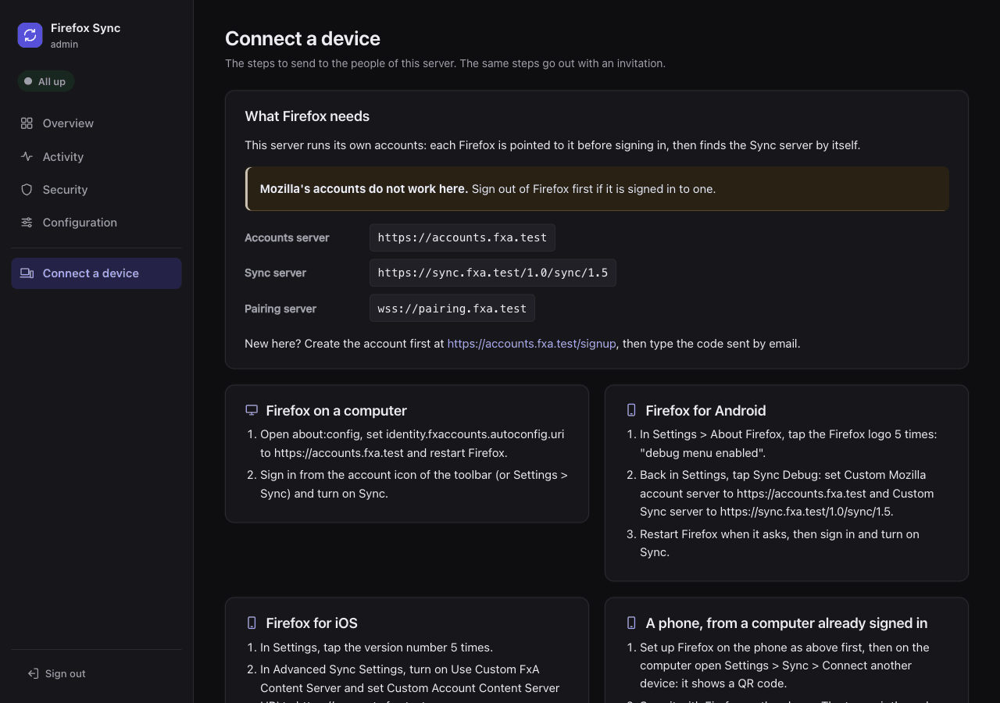

# Set up Firefox

This page points Firefox on desktop, Android and iOS to your server. Follow [Mozilla's accounts](#mozillas-accounts) if Firefox signs in with a Mozilla account, or [Self-hosted accounts](#self-hosted-accounts) if you run the accounts too. Install the server first: see [the index](README.md#choose-your-path).

## Before you start

- Do this on every device, starting with the one that has the most data.
- If Firefox is already signed in, sign out first: `Settings` > `Sync` > `Sign out`, and keep the data on the device when Firefox asks. Firefox reads the server addresses only when it signs in.
- The examples use `https://sync.example.com` for your `SYNC_PUBLIC_URL` (`syncDomain` with the Helm chart) and `https://accounts.example.com` for your `FXA_CONTENT_URL`. Use your own.
- The admin UI shows these steps with your values: see [From the admin UI](#from-the-admin-ui).

## Mozilla's accounts

Firefox keeps signing in at `accounts.firefox.com`, and stores its Sync data on your server.

### Desktop

1. Open `about:config` in a tab, accept the warning and search for `identity.sync.tokenserver.uri`.
1. Change it from the default to `https://sync.example.com/1.0/sync/1.5`.
1. Sign in to Firefox with your Mozilla account, and turn on Sync.

To go back to Mozilla's servers: sign out, reset `identity.sync.tokenserver.uri` in `about:config`, and sign in again.

### Android

1. Go to App Menu `⋮` > `Settings` > `About Firefox`, and tap the logo 5 times. Firefox shows `debug menu enabled`.
1. Go back to the main settings menu. `Sync Debug` is at the top, just under the `Synchronize and save your data` box: tap it.
1. Tap `Custom Sync server`, and set it to `https://sync.example.com/1.0/sync/1.5`.
1. Sign in to Firefox, and turn on Sync.

### iOS

1. Go to App Menu `≡` > `Settings`, and tap the version number 5 times, towards the bottom (for example `Firefox 127.1 (42781)`).
1. Go back to the top of the main settings menu. `Advanced Sync Settings` is just under `Sync and Save Data`: tap it.
1. Turn on `Use Custom Sync Token Server`, and set `Custom Sync Token Server URI` to `https://sync.example.com/1.0/sync/1.5`. Leave the `Custom FxA Content Server` options alone: they are for self-hosted accounts.
1. Sign in to Firefox, and turn on Sync.

## Self-hosted accounts

Firefox is pointed to your accounts server, which tells it where your Sync server is. Mozilla's accounts do not work with your server: each person needs an account created on it. They sign up from Firefox, or from an [invitation](admin/accounts.md#invitations) of the admin UI.

### Desktop

1. Open `about:config` in a tab, accept the warning and search for `identity.fxaccounts.autoconfig.uri`.
1. Set it to `https://accounts.example.com`.
1. Restart Firefox.
1. Sign in from the account icon of the toolbar, or from `Settings` > `Sync`. The sign-in page must be on `accounts.example.com`. New accounts are created there too, with a code sent by email.
1. Turn on Sync.

To go back to Mozilla's accounts: sign out, reset `identity.fxaccounts.autoconfig.uri` in `about:config`, and restart Firefox.

### Android

1. Go to App Menu `⋮` > `Settings` > `About Firefox`, and tap the logo 5 times. Firefox shows `debug menu enabled`.
1. Go back to the main settings menu. `Sync Debug` is at the top: tap it.
1. Set `Custom Mozilla account server` to `https://accounts.example.com`.
1. Set `Custom Sync server` to `https://sync.example.com/1.0/sync/1.5`.
1. Restart Firefox when it asks, then sign in and turn on Sync.

### iOS

1. Go to App Menu `≡` > `Settings`, and tap the version number 5 times, towards the bottom.
1. Go back to the top of the main settings menu, and tap `Advanced Sync Settings`.
1. Turn on `Use Custom FxA Content Server`, and set `Custom Account Content Server URI` to `https://accounts.example.com`.
1. Sign in, and turn on Sync.

## Pair a phone

With self-hosted accounts, a phone can also sign in from a computer that already is.

1. Set up Firefox on the phone as above first.
1. On the computer, open `Settings` > `Sync` > `Connect another device`. It shows a QR code.
1. Scan it with Firefox on the phone.

The two pair through Mozilla's pairing server, or through yours: see [Pairing](reverse-proxy.md#pairing).

## Check that it works

Open `about:sync-log` on the desktop: the newest logs show no errors.

## From the admin UI

The admin UI's **Connect a device** page, in its menu, shows the steps of this page with your server's values. With self-hosted accounts, its [invitations](admin/accounts.md#invitations) send them by email.

